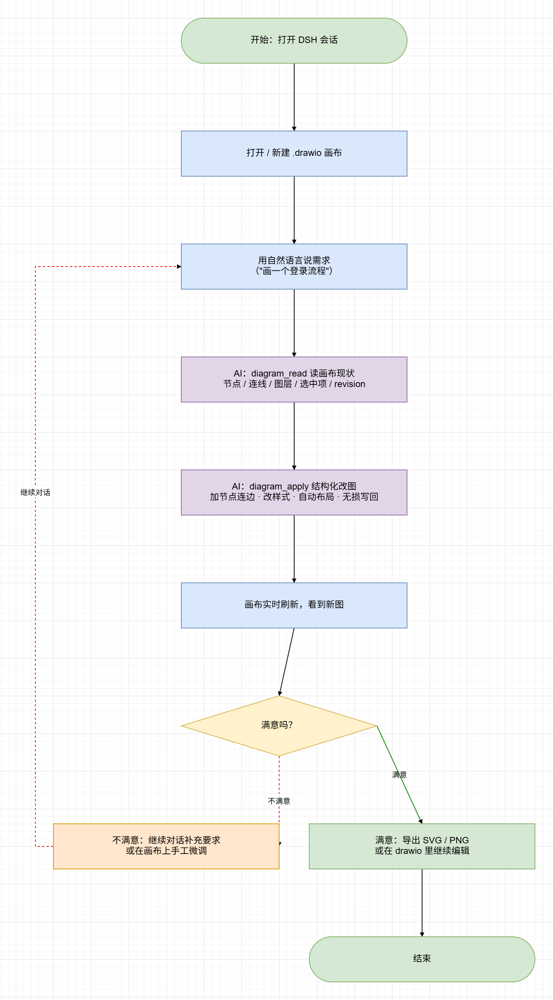
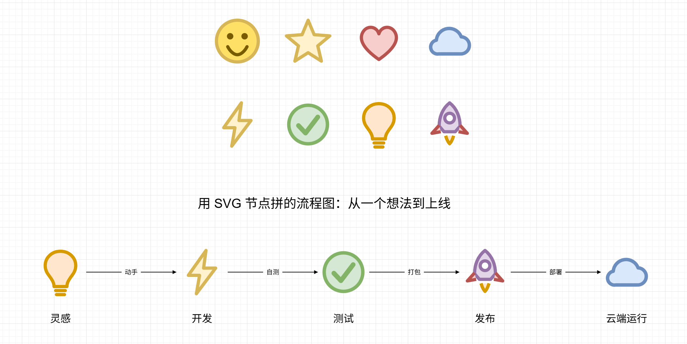
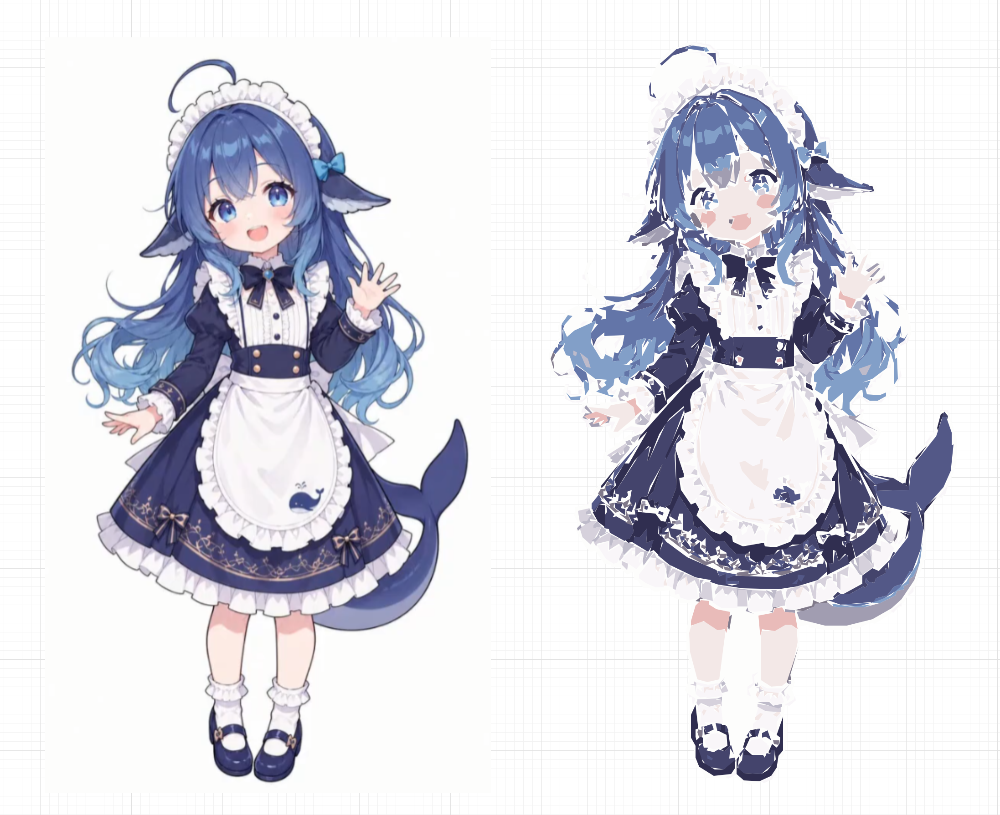

<!-- 待补：社交预览图。放好 docs/social-preview.png（1280×640）后，把下面这行的注释去掉即可。

-->

# dsh-drawai

[](https://github.com/fourzkw/dsh-drawai) [](https://www.npmjs.com/package/dsh-drawai) [](LICENSE)

## 功能一览

`dsh-drawai` 把可编辑画布放进 DeepSeek Harness 右侧栏，并给模型两个改图工具；人和 AI 读写同一份画布。新建默认使用 `.drawai` 原生 JSON，旧 `.drawio` 在界面打开时自动迁移并保留原稿。

原生格式、媒体目录、自动迁移和兼容说明见[原生画布文档](docs/native-canvas.md)。

1. **右侧栏可编辑画布** —— 打开 / 新建工作区 `.drawai` 或 `.drawio`：画节点、连边、就地改字、分层、排序、对齐、导出；双击即可改标签。
2. **自然语言改图** —— 对话里说需求，模型用 `diagram_read` / `diagram_apply` 读现状、结构化改图、自动布局并原子写回。
3. **选区感知与回退** —— 你在画布上选中什么，模型就知道什么；模型改动最多可退 8 步。
4. **SVG 图形节点** —— 图标 / logo 可直接当节点内容，拼流程图与示意图。
5. **位图矢量化（`traceImage`）** —— 照着工作区图片逐像素描成 SVG 节点，不是凭印象手写近似图。
6. **原生文档与 drawio 兼容** —— `.drawai` 保存多页、节点扩展和叠放顺序；旧画布迁移保留完整 XML 与原媒体，支持另存为 `.drawio`。
7. **视频复刻** —— 选中已导入视频，点击悬浮工具条「绘制复刻」自主设置画质、帧率、完整视频或起止范围，自动抽帧并绘制成 SVG 视频；显示预计帧数、实际进度与帧预览，支持取消，原视频保留。支持 SVG 帧序列包，以及保留原帧率、白底和片段音频的 MP4 / WebM 离线导出；也可导出白底、循环播放的无声 GIF。渲染、编码和保存由宿主后台执行，切换标签或刷新网页后仍继续，完成文件自动保存到画布旁（编码需 FFmpeg）。详见[视频节点说明](docs/video-nodes.md)。
8. **文生图节点** —— 右侧元素条「文生图」放一个节点，写段提示词就出图：后端可以是本机 **ComfyUI**（默认 Qwen-Image 2.1 工作流，也能换成你自己的），也可以是任意 **OpenAI 兼容**的生图 API。图片是节点内容，提示词就是图片下方那行文字，改完可原地重新生成。

9. **节点绘制视频** —— 选中视频节点，先用 `shotcraft_search` 挑几张镜头卡连到它（连线顺序=镜头顺序，卡片时长=段长；**卡必须连**，断连的卡会被 `motion_project create` 直接拒绝），再说一句要做什么：`motion_project` 按卡片排好时间轴，并把**分镜表**（每镜做什么/屏幕上出现什么/配什么字）写进工程；先只写 `scene-0`、`motion_preview` 看一张**定调帧**把风格定住，再铺开写其余场景。AI 在对话里直接读写 `scene-*.tsx`，`motion_render` 在后台渲染，完成后 `motion_render apply` 把成片落成画布上能播的 clip pack。**只有对话里这一个 agent**：没有第二套后台 agent、不需要轮询、不用等任务面板。详见[动效视频说明](docs/motion-video.md)。

10. **音频、音效、旁白与踩点** —— 把 BGM、旁白挂进时间轴（`motion_audio add`），渲染时由画面侧一起播放，淡入淡出与「旁白期间压低 BGM」都在音量曲线上算；旁白用 `motion_voice` 合成（脚本一句一行，台词决定镜头多长，字幕自动进 `timeline.subtitles`）；音效可用 `motion_sfx` 从 Freesound 搜（**不按许可过滤**，每条结果带许可标签，用哪条由人决定），下载时保存来源和许可信息至音频素材索引，需署名时根据索引自行整理。`motion_audio analyze` 给出 BPM 与等距节拍网格，`motion_audio apply` 把切镜吸到拍子上，`motion_audio_verify` 再从成片音轨回测对拍误差。详见[声音制作说明](docs/motion-audio.md)。

11. **素材捕获与看帧验收** —— 图片、音频、视频可捕获进工程 `assets/`（`motion_assets`，附尺寸、色板、峰值），**产品界面还能用 `motion_assets page` 让无头 Chrome 把一段 HTML 模板或网址截成 2 倍图**（截到登录页/错误页/空白页会直接报错，不会静默存一张假界面），场景里用 `staticFile()` 引用；`motion_preview` 一次渲染多帧拼成一张图直接回给对话，不用等整片渲染就能看版式。详见[动效视频说明](docs/motion-video.md)。








## 安装 / Install

```sh
# 从 npm 安装（推荐：预构建，跳过 allowBuilds 构建授权）
dsh plugin --profile web add dsh-drawai

# 或者直接从 GitHub 装（仓库里没有 prepare 脚本，同样不需要构建）
dsh plugin --profile web add github:fourzkw/dsh-drawai
```

然后**重启 `dsh web`** —— 宿主侧只在启动时加载，这一步不能省。

> **更新到最新版**：`dsh plugin --profile web update dsh-drawai@latest`

重启之后，你会看到：

| 装好后的变化 | 出现在哪里 |
|---|---|
| 「DrawAI 画布」面板，负责打开 `**/*.drawai` 和 `**/*.drawio` | 右侧栏 |
| `diagram_read` / `diagram_apply` / `shotcraft_search` | 模型工具集 |
| `motion_project` / `motion_preview` / `motion_render` / `motion_assets` / `motion_audio` | 视频工程工具 |
| `drawai-canvas` 技能 | 会话技能目录（模型按需取全文） |

- 两种装法都不需要 `allowBuilds` 构建授权：npm 包是预构建的；GitHub 源码包里 `lib/` 也已提交、没有 `prepare` / `postinstall` 脚本。
- 手动挂载的兜底写法，以及本地 link 的开发做法，见[设计文档的「安装」一节](docs/design.md#安装)。

## 使用 / Usage

人和模型共享同一画布文档；对话可直接编排节点、建视频工程、改场景、看预览和出片。迁移后以 `.drawai` 为主，原 `.drawio` 作为保留原稿；外部编辑原稿会提示版本冲突。

| 入口 | 你能得到什么 |
|---|---|
| **右侧栏画布** | 打开或新建画布、画节点与连线、就地改字、图层、分区、顺序、多选对齐、查找、微移、多页切换、复制粘贴、导出 SVG / PNG / 透明 PNG（4×，含导出选中） |
| **`diagram_apply`** | 让模型按 ops 改图：增删改、重接边、复制、排序、分层、导出；支持 `ids` 批量、`as` 别名、`expectRevision` |
| **`diagram_read`** | 让模型看见图的结构与样式、图层与父级、页面尺寸、你此刻的选区、文件指纹 `revision` |
| **`motion_project`** | 建/打开视频工程：按挂上来的镜头卡排时间轴，写 `timeline.json` 与 `scene-*.tsx` 桩 |
| **`motion_preview`** | 渲染指定几帧并拼成一张图直接回图（首次打包 10–30 秒，之后复用缓存） |
| **`motion_render`** | `start` 立刻返回 jobId、后台渲染；`status`/`list`/`cancel`；`apply` 把成片回填成画布 clip pack |
| **`motion_assets`** | `list` 看工程素材，`library` 搜插件纹理和乐器采样，`use` 按需导入；另支持 `capture`、`crop`、`palette`、`page` 等 |
| **`motion_audio`** | 音轨增删与对齐：`list`/`add`/`remove`/`analyze`（节拍网格）/`apply`（钉帧） |
| **`motion_sfx`** | 音效采购：`search`（Freesound，不按许可过滤，结果带许可）/`get`（下载 + 详情页许可复核 + 署名清单）/`list` |
| **`motion_audio_verify`** | 从成片音轨回测每拍偏差，超过 2 帧判不合格 |
| **`motion_voice`** | 旁白：`plan`（脚本→估时长→重排镜头→写字幕，不合成）/`say`（合成后再按真实时长重排）/`align`（只按已有音频重排）/`list`。脚本 `voice.script.md` 一节一句，台词决定镜头多长 |
| **`motion_task`** | 旧任务记录：`list`/`status`/`cancel`/`focus`/`remove`（新流程不用它开工） |
| **选中与回退** | 你选中什么模型就知道什么；模型的每一轮改动都能在界面上退回去 |
| **文生图** | 元素条（后台任务入口上方）放节点 → 写提示词 → 悬浮工具条「文生图」面板点生成；后端与地址在偏好里配（ComfyUI / OpenAI 兼容） |

## 🗂️ 画布面板 / The canvas panel

刚打开面板时它是**空的**（不会替你预开一张图）：用 `文件 → 新建画布…` 或 `文件 → 打开…`（列出工作区里所有 `.drawio`）开始。

| 功能 | 它解决什么问题 |
|---|---|
| **画布外观** | 矩形 / 圆角 / 椭圆 / 菱形 / 圆柱 / 文档 / **SVG 图形** / **位图** 等形状族（右侧元素条按族放置）、8 色调色板、白纸 + 网格、正交折线 + 障碍避让、明暗切换 |
| **SVG 图形节点** | 节点内容直接是一段 **SVG 标记**（图标 / logo / 示意图这种形状词汇表里没有的东西）：右键「SVG 内容…」贴进去即可，或让模型用 `addNode {shape:"svg", svg:"<svg viewBox…>…</svg>"}`。落盘是 drawio **原生**的图片形状（`shape=image` + `image=data:image/svg+xml,<百分号编码>`），所以 drawio 桌面版打开同样画得出来；标记只喂给 `<image>`（独立文档，脚本不执行、也不碰页面 DOM） |
| **内嵌位图** | 从剪贴板粘贴或拖入 PNG / JPEG / GIF / WebP，画布会**真的画出来**（同为 `shape=image` + data URI）。`diagram_read` 把 base64 省略成 `«image N 字符»`，不撑爆上下文 |
| **位图矢量化 traceImage** | 让模型照着工作区里一张图**逐像素**描成 SVG 内容节点（读像素 → 按必填的 `removeBg` 决定是否泛洪抠底 → k-means 调色板 → 3× 超采样归类 → 按颜色取像素级闭合轮廓 → 每色一条 nonzero path）。形状词汇表表达不了的照片 / 插画走这条，而不是让模型手写一段近似 SVG 冒充复刻 |
| **文本** | 双击节点就地改字。独立文字和普通图形标签可对选中文字设置粗体、斜体、下划线、删除线、字色和字号；图片和视频节点不显示文字 |
| **表格** | 元素条可新建表格；Markdown 表格与已有分镜表显示为网格，双击或选中后可逐格编辑。分镜仍以 Markdown 保存在一个节点中供视频工程读取 |
| **连线** | 四选一画法（直线 / 直角折线 / 圆角折线 / 曲线）× 线型（含虚线间距）× 箭头（单向 / 双向 / 无 / 反向）× 颜色 × 引出段长度；自环；悬空端（从节点脱开后成为自由端点，还能再拖回去） |
| **连线上的文字** | 双击改、按住拖（半格 + 贴线吸附）、右键「标签居中」；**线在文字的位置真的断开**（不盖白底） |
| **选中与移动** | 框选 / Shift 加选 / `Ctrl+A`；整体拖动（折点与自由端点跟着同一个位移走）；对齐辅助线；多选对齐与分布 |
| **图层** | 列出 / 新建 / 显示隐藏 / 锁定 / 重命名 / 删除（合并到邻层）/ 选中移层 / 设为当前层；隐藏与锁定写入文件 |
| **顺序** | 置顶 / 上移 / 下移 / 置底 —— 写回时**真的改动文件里单元的先后**（否则重新打开就变回去了） |
| **自定义数据** | 右键「编辑数据」，按 `key=value` 一行一项改单元属性；按 user object 存回文件，drawio 打开不会丢 |
| **导出** | SVG / PNG(4×) / 透明 PNG(4×)；「看一眼画布效果」走 DSH 附件服务，**不在工作区落文件** |
| **回退** | 「编辑 → 撤销 AI 改动」最多可以连着退 8 步 |

## 🤖 模型工具 / Model tools

### `diagram_apply` —— 模型怎么改图

结构化 ops，改完自动布局并**原子写回**（布局默认 `dagre-tb`，另有 `dagre-lr` / `grid` / `none`）：

| 类别 | ops |
|---|---|
| 增删 | `addNode` `addEdge` `remove` `duplicate` |
| 修改 | `setLabel` `setLabelPos` `setStyle` `setEdge` `move` |
| 结构 | `addLayer` `setLayer` `setLayerProps` `order` |
| 交互 | `highlight`（让画布替你选中，不改文档、不重排） |
| 输出 | `export`（`svg` 落在 `.drawio` 旁边；`png` 走浏览器下载） |
| 图像 | `traceImage`（把工作区里一张位图**逐像素**矢量化成 svg 内容节点） |

- **批量修改**：`setStyle` / `setLabel` / `move` / `remove` 都接受 `ids:[…]`，不必发 N 个 op。
- **`expectRevision`**：把上次 `diagram_read` 返回的 `revision` 传进来 —— 对不上（说明你在 drawio 里同时改过）就**报错，且一个字节都不写**，重读再改。
- **写盘之前就报错**：边引用了不存在的节点会直接失败，并列出已知 id。
- **不动手工摆好的版面**：ops 里自带几何时（`addNode` 给了 `x/y`，或者有 `move`）不会重排 —— 否则"挪 40px"会被布局立刻冲掉。
- **画图形用 `svg`**：`addNode {shape:"svg", svg:"<svg viewBox…>…</svg>", w, h}` 让节点内容就是那段标记（`setStyle {id, svg:"…"}` 换图、`svg:null` 清掉回到矩形）。标记**必须带 `viewBox`**，否则放大缩小时图形不会跟着变；缺 `xmlns` 宿主会补。
- **照着一张位图描矢量图用 `traceImage`**：

  ```
  diagram_apply({ op:"traceImage", image:"refs/角色.png", removeBg:false, x:40, y:40 })
  ```

  它**真的去读那张图的像素**，在宿主里跑一条完整管线：

  | 步骤 | 做什么 |
  |---|---|
  | ① 解码 | PNG 走**自带解码器**（零依赖，只用 `node:zlib`）；JPEG/GIF/WebP 需要宿主装了 sharp |
  | ② 去背景 | **`removeBg` 必填**（无 auto）：`true` = 抠（先识纯色底，否则近白泛洪）；`false` = 整图保留。由模型按图意判断后传入 |
  | ③ 调色板 | k-means（K 默认 12，k-means++ 初始化，多次重启取最优）；背景单独占一色 |
  | ④ 归类 | 3× 双线性超采样 → 3×3 众数滤波 → 降回原分辨率 → 小于 `minArea` 的碎块并进**颜色最接近**的邻色 |
  | ⑤ 轮廓 | 按颜色分 4 连通域，沿**像素格边**建"区域恒在左侧"的有向图，左转优先走闭合环（外环顺时针 / 洞逆时针） |
  | ⑥ 输出 | RDP 简化 + 相对增量编码 → 每色一条 `fill-rule="nonzero"` 的 `<path>`，按面积降序铺 |

  - 默认 **`w/h` = 原图像素尺寸**（裁剪时为裁剪块尺寸）；`viewBox` 使用工作图局部坐标，内容铺满节点框。裁剪时 `x/y` 默认取裁剪原点，按原图像素 1:1 放置；显式 `w/h` 表示裁剪块的目标尺寸。
  - 要更简洁：`colors` 调小、`scale:2|3`（先降采样）、`grid` 调小；要更保真：`epsilon` 调小（默认 2px）、`minArea` 调小（默认 10px²）。
  - 返回的 summary 会报**色数 / 路径数 / 轮廓环数 / 字符数 / 量化图轮廓是否无损**。`labelPartitionComplete` 只验证标签分区完整；`exactPixelCoverage` 还要求最终输出保留全部前景轮廓几何，两者都不代表与原图颜色、细节一致。简化后无法证明无损时 `drawnPixels` 为 `null`。
  - 字符预算充足时不额外按环面积删除小碎片；风格由减色、`epsilon` 与 `minArea` 等参数控制。预算紧时仍会进一步简化、删小环，回执中的 `attempts / appliedEpsilon / loopsDropped / budgetExceeded` 会报告降级与超预算情况。
  - 单次硬上限：SVG 标记 250000 字符（默认预算 248000）；宿主先收紧轮廓，仍超硬上限才报错让你调参。
  - 落盘仍是 drawio **原生**的图片形状（`shape=image` + `image=data:image/svg+xml,<百分号编码>`），drawio 桌面版打开同样画得出来。
  - **它不是"让模型凭印象画"**：形状取决于像素，同一张图同样的参数跑两次结果一致（已纳入自测）。

  **图像节点工具栏绘制**：单选已导入的位图节点，浮动工具栏出现「绘制」（与填充/描边同款悬停悬浮卡片）。卡片内可选碎片数量档位、画风、颜色数与是否去背景；点「让大肥鱼开始画画！」后先分析原图，再从大色块到细节自动逐步展示完整复刻图，展示过程只保留进度条；原图保留，结果在右侧新建 SVG（同尺寸与图层）。最终完整 SVG 一次落盘，过程不逐帧保存，走正常的撤销和保存通道。

  | 碎片数量 | 效果 |
  |---|---|
  | 低 | 粗颗粒棱角色块，保留明显折面与尖角 |
  | 中 | 中等碎片密度，增加装饰与局部轮廓 |
  | 高 | 细密棱角碎片，保留更多发丝、衣饰和五官色块 |

  三档以用户提供的三张碎片画风参考图校准，统一使用减色、超采样归类、受保护的小块合并和折线轮廓管线。高档基准长边为 887px，低/中档采样密度分别约为高档的 64%/80%；小图按自身尺寸等比适配，不虚增分辨率。对于校准原图，工作图分别为 320×569、400×711、499×887，三档都使用 2px 折线容差和 10px² 小块阈值。小图的容差、面积阈值按尺寸归一化；不再使用原始像素标签直出或多轮强力合并来追赶数量目标。

  数量区间按当前图像实际测量：分别计算三档碎片数，结合有效面积、碎片密度给出本图参考范围，不为凑数字破坏已校准的画风。极少色图片降采样后若重新聚类产生更多过渡色碎片，会复用高档调色板，避免低档反而更碎。平坦或孤立同色块图片的三档数量可能相同；颜色数独立控制，内部容量无需选择，超限导致额外简化时提示细节降低。外链或相对路径图片须先导入为内嵌位图。

### `diagram_read` —— 模型怎么看见图

读回：节点 / 边 / 标签、每个单元的**样式键**（就是文件里那串 `style`，另外给出派生的形状、线型、箭头、颜色名便于阅读）、图层表与单元所属层、容器父级 `parent`、页面尺寸、边标签的 `labelX/labelY`、**`revision`**（文件内容指纹）、当前选区。SVG 图形节点的内容单独放在 `svg` 字段里（style 串里的 `image=` 则省略成 `«svg N 字符»`，避免一次读取被 data URI 撑爆）。

- 可以只读一层（`layer`）或只看几个单元（`ids`）—— 大图上能省下不少上下文；过滤时会同时报 `totalNodes` / `totalEdges`，免得漏看。
- `render:true` 会让画布把当前画面渲成 PNG 交给模型"看一眼"；图片走 DSH 的附件服务，**不在工作区落任何文件**。

### 让模型少猜的三条通道

| 通道 | 它解决了什么 |
|---|---|
| **选区上报** | 你在画布上选中什么，模型读得到 —— "把这几个改一下"里的"这几个"（按文件配对、按存在过滤） |
| **当前画布** | 不传 `path` 时默认就是你正打开的那张；切换标签页会主动告诉模型换成了哪张 |
| **结构化返回 + 别名** | 返回的 `created` / `changed` / `removed` 都带 id，不必解析自然语言；`{op:'addNode', as:'start'}` 之后，同一个 ops 数组里就能直接 `from:'start'` |

一段典型的对话是这样的：

```
你：画一张登录流程图，三条分支
模型：diagram_apply(addNode×5 + addEdge×5 + layout:'dagre-tb')
      → 写回 docs/登录流程.drawio，返回 created / changed / removed（含自动分配的 id）

你：（在画布上框选两个节点）把这两个换成绿色
模型：diagram_read → 看到 selection:["n3","n5"] → diagram_apply(setStyle, ids:["n3","n5"], style:"green")

你：这张图导出一份给我
模型：diagram_apply(export, format:"svg") → 渲染在浏览器侧执行，SVG 落在 .drawio 旁边
```

## 📄 载体：原生 `.drawio` 文件 / Native `.drawio` files

**不需要导入导出，也不把你锁在私有格式里。** 画布读写的就是 `.drawio` 本身（drawio 的 mxfile），
所以同一份文件可以直接用 drawio / diagrams.net 打开接着改，改完回到画布上也照样能编辑。

**难点不在读，在写。** 这个格式能表达的东西比本画布多（多页、分组层级、图片、HTML 标签、自定义属性、旋转翻转、页面设置…），
而本画布只理解其中一个子集。如果写回是"按模型重新生成整份 XML"，用户稿子里我们不理解的部分就会在保存时**被悄悄删掉** ——
"悄悄"是最糟的失败方式（用户以为在编辑，其实在删）。所以写回做的是**外科手术**：

| 规则 | 说明 |
|---|---|
| 页 1 的 `<root>` 之外 | 其他页、mxfile 属性 —— **逐字节保留** |
| 我们拥有的单元（节点 / 边） | 只重写 `value` / `style` / 几何 / 端点这几处属性，其余原样 |
| 我们不认识的单元 | 原样留着，不因为不认识就删 |
| 只有"导入过、模型里又没了"的单元 | 才删 —— 那才是用户真的删掉了它 |
| 压缩形态 | 原本压缩的页体，写回后依然压缩 |

由此得到一条可以断言的性质：**打开后原样保存，文件逐字节不变**（`tools/check-mxfile.mjs` 里有断言盯着）。

**读不懂的地方一律如实报。** 多页可切换编辑当前页（其它页原样保留）、分组按绝对位置显示、**外链 / 相对路径**图片按矩形占位（内嵌 SVG 与内嵌位图会真的画出来）—— 这些会作为 `notes`
出现在工作栏和 `diagram_read` 的返回里。用户会拿这份文件继续在 drawio 里编辑，不说明就等于骗人。

`revision` 不是时间戳，而是**文件内容的指纹** —— 所以无论 drawio 还是别的编辑器改过文件，乐观锁照样准。

画布是自己实现的：纯 SVG + DOM，没有 iframe，也不依赖任何外部编辑器资源。换来的是每个单元都有
id / layer / parent、选区能上报给模型、写回是逐单元的、画布本身能被模型驱动；代价是只覆盖这个格式的一个子集。

## 🎨 文生图节点 / Text-to-image node

右侧元素条「文生图」（在后台任务入口上方）落一个**文生图节点**：上面是图片、下面那行文字是提示词（就是节点标签，双击可改）。选中它，悬浮工具条里出现「文生图」面板：

1. 在面板里填提示词、点「生成」——结果直接替换节点图片，节点按 480px 长边压缩显示；
2. 面板里可改尺寸（1024×1024 / 832×1248 / 1248×832，或自定义 256–2048）、步数（默认 20）、种子（0 = 随机）；「重新生成」沿用节点上记着的上次参数。

**两种后端**（偏好面板「文生图」区切换，`设置 → 文生图`）：

| 后端 | 怎么配 | 说明 |
|---|---|---|
| ComfyUI（本机） | 地址默认 `http://127.0.0.1:8188`；内置一份 **UI 格式**的 Qwen-Image 2.1 文生图工作流，也可粘贴自己的工作流（ComfyUI 菜单「导出」或「导出 (API)」两种格式都认） | 需要 ComfyUI 正在跑、且工作流用到的节点/模型都在；宿主会读 `/object_info` 把 UI 工作流转成 API 格式，再把提示词、尺寸、步数、种子注入进去 |
| OpenAI 兼容 API | 接口地址（默认 `https://api.openai.com/v1`）、API key、模型名 | 走 `POST /images/generations`（`response_format: b64_json`），同协议的任何网关都能接 |

- **结果存在哪**：图片以 data URI 内嵌进 `.drawio`（与粘贴的位图同一条路径），提示词是节点标签，不产生旁路素材目录。1024×1024 的 PNG 通常 0.9–1.5MB，画布里攒很多张时文件会明显变大。
- **耗时**：8GB 显存的 RTX 5070 Laptop 上，1024×1024 / 20 步约 60 秒（首次还要加载模型）；单次请求宿主最长等 5 分钟，超时/报错会显示在工具条里。
- **不会被偷偷改写提示词**：内置 Qwen 工作流里有「提示词改写（PE）」支路，默认把它剪掉——你写什么就画什么，9B 改写模型不加载。
- **AI 侧也能生成**：`diagram_apply` 的 `imagegen` 不在工具面里；文生图目前只从画布 UI 发起（宿主 action `imagegen-generate`），避免模型在对话里悄悄花你的显卡/API 额度。

## ⚙️ 配置与默认值 / Configuration

**目前还没有设置页**：下面这些默认值都写在代码里；能通过 AI 侧改的，在右列给出等价做法。

| 现在的默认值 | 怎么改 |
|---|---|
| 自动布局默认 `dagre-tb` | `diagram_apply` 的 `layout: 'dagre-lr' / 'grid' / 'none'` |
| 节点与独立文字默认字号 12、连线 10 | 画布右键「字号」，或 ops 的 `fontSize:18`（`null` = 删键回缺省） |
| 缺省线型（实线、单向箭头、直角折线） | 画布右键，或 ops 的 `dash` / `arrow` / `line` |
| 像素格 10px、吸附半格 5px | 菜单「整理几何（吸附到格线）」做一次性对齐 |
| 文字多的节点**纵向自适应**（只长不缩，独立文字不参与） | 不用调 —— 标签换行所需的高度会写回文件的 `h` |
| 主题跟随 DSH 的明暗 | —— |
| 显示层、当前层 | 「图层」菜单（会写进文件） |

**文生图默认值**（与本机自定义颜色存在同一处浏览器 localStorage）：ComfyUI 地址 `http://127.0.0.1:8188`、内置 Qwen-Image 2.1 工作流、尺寸 1024×1024、步数 20；OpenAI 兼容默认地址 `https://api.openai.com/v1`、模型 `gpt-image-1`。API key 以明文存浏览器 localStorage（本机自用没问题，共享机器别填）；生成请求只带当前会话的 `sessionId`，宿主不落盘 key。

**右侧常驻元素条**：按类型（图形 / 文字 / 分区 / SVG / 图片）放置，点画布落下**一次**即卸工具；
「图形」的矩形、圆角、菱形等是同族变体，只在侧面板展开，不全部铺在主条上。选中图形后可换同族形状；悬停画布节点不会触发右侧工具栏浮窗。

**选中后的浮动样式工具栏**：选中图形或连线，会在选区附近显示单行工具栏，图标在上、文字标签在下。悬停入口自动展开上方浮窗；形状以图标网格展示，填充与字色使用色板，描边面板合并线型、粗细、颜色和不透明度，字号提供常用档位与手动输入。选中连线时还可改线型和箭头。支持批量修改，保留每个对象未修改的样式；字号输入后按 Enter 或点击外部生效。窄面板可水平滚动，右键菜单仍可使用。

图片、视频绘制及 AI 视频抽帧由宿主持久队列执行，提交前自动保存素材，不需要手工确认保存。切换页面、对话、关闭画布或刷新网页后继续计算并安全写入原画布。统一后台任务面板支持筛选、排序、暂停续绘、重试、打开原页面和撤销单次生成；发生冲突时保留产物及本地编辑。宿主重启后未完成绘制标为中断，可校验检查点后继续；导出需重新编码。原视频和复刻片段保留音频来源。详见[后台任务说明](docs/background-workflow-assessment.md)。

「形状」仅在选区内的节点全部属于基础图形时显示，选项也仅包含矩形、椭圆等基础图形。SVG、图片、文字、分区节点及包含这些节点的混合选区不提供直接换形入口，以保留原有内容和节点类别。

图片、SVG 内容和视频默认没有外框，不提供无效的描边工具；独立文字同样隐藏描边。混合选择时，描边只修改有边框的图形和连线。图片、视频及独立文字的右键菜单只提供字色，不提供无效的填充与描边配色。

单选图像或 SVG 节点，通过悬浮工具栏「导出图片」或右键菜单即可下载，无需先保存画布。位图保留 PNG / JPEG / GIF / WebP 原格式、原始分辨率和透明度；SVG 可选择「导出 SVG」保留矢量内容，或「导出 PNG」按节点尺寸的 4× 分辨率生成透明背景位图（超大尺寸自动限制）。文件名优先使用节点标签，没有标签时使用节点 ID。

浮动工具栏的填充、描边和字色均使用色板：点击颜色入口展开 24 个标准颜色与已保存的自定义颜色。自定义颜色可用取色器或输入 `#RGB` / `#RRGGBB`，点击「添加并应用」后存入本机偏好；三个颜色入口及本机其他画布共用自定义颜色，刷新后仍保留。

各工具面板以独立浮窗优先显示在工具栏上方，靠近窗口边缘时自动调整位置，不撑开工具栏。移出入口后延迟关闭，鼠标进入浮窗会保持打开；点击外部或按 Esc 关闭。色板使用圆形色块、蓝色选中色环与「无颜色」选项，点击「＋」展开自定义颜色输入；底部滑杆可设置填充、描边或文字的不透明度，选色后面板保持打开以便继续调整。

右键菜单用于编辑，不提供创建元素入口：空白处保留撤销、重做、全选和粘贴；节点、连线与多选菜单提供复制、剪切、粘贴等操作，不可用时禁用。新建图形或连线请使用右侧元素条；已有 SVG 节点仍可右键编辑 SVG 内容。

**图层面板**：右上角「图层」以列表显示每层的内容缩略图、名称、元素数量、可见性和锁定状态，隐藏层也保留缩略图。点击名称或缩略图设为当前层；双击名称或点击铅笔编辑名称，Enter/点击外部保存，Esc 取消。新建图层会立即进入命名；更多菜单可合并并删除图层，删除时内容移入相邻层。底部的目标选择器可移动选中元素，锁定层不能作为目标；超过八层时支持搜索。

**导出面板**：右上角「导出」可选择当前页全部可见图层、选区、当前图层或指定多个图层，支持 PNG/SVG、透明背景与文件名。展开「更多设置」可指定像素宽高、保持宽高比、调整四周留白、独立开关网格，并选择预设或自定义背景色；PNG 也可按 1×/2×/4× 输出。面板显示实际输出尺寸，并通过编码预估文件大小，下载复用相同结果。显式选择隐藏图层时也会导出其内容。PNG 单边最多 16384 像素、总像素约 3200 万，超出时等比缩小并提示；SVG 保留矢量内容。导出设置记入本机偏好。文件、编辑、视图菜单按用途分组，快捷键单列；页面切换集中到视图中的页面选择器。

**就地文字编辑**：双击节点或连线标签开始编辑，`Enter` / `Shift+Enter` 换行，点击外部或 `Ctrl+Enter`（Mac 为 `Command+Enter`）完成，`Esc` 取消。输入法确认文字不会提前完成编辑。

独立文字和普通图形标签支持部分 draw.io 富文本格式，并可在 `.drawai` 保存及 `.drawio` 往返中保留。导入的复杂 HTML 经安全过滤后显示，完整 HTML 表格和连线富文本等仍不完整；混合字号的换行与对齐可能和 draw.io 不完全一致。表格节点的单元格编辑会以纯文字保存，若原有局部样式会在编辑器中提示。

选中文字节点后调整「字色」或「字号」，会统一整段文字的对应属性，保留粗体、斜体等其他格式；双击进入编辑并选中部分文字后设置格式，仅影响选中的文字。工具栏与弹出面板会尽量留在窗口内。

编辑框与显示标签共用文字区域、字体、行高和缩放：普通节点居中，分区标题左上对齐；换行在浏览器中按实际字体宽度计算，编辑中的节点撑高会先预览再提交。连线标签也支持多行显示，并按实际字号设置编辑框与连线避让区域。

**连线工具与修改入口**：悬停右侧连线图标选择直线、直角折线、圆角折线或曲线，然后在空白处拖拽确定起终点；直接点击连线图标使用上次选择的类型。连线工具用于新建；修改已有连线请选中后使用浮动工具栏的「线型」，也可使用右键菜单。

## 须知 / Good to know

- **兼容性**：DSH（DeepSeek Harness）Web `0.1.x` 与 `0.2.x`（含 `0.2.0-rc.*`）；官方包以 `peerDependencies` 声明（`@deepseek-ai/dsh-tools`），Node `>= 20`。
- **生效方式**：宿主侧只在 `dsh web` 启动时加载，换 `lib/index.js` 必须**重启**；客户端是独立 bundle，刷新页面即可。
- **界面语言**：目前只有简体中文，还没有 i18n。
- **大图性能**：几百个单元时的重渲染与路由开销还没测过。
- **数据与网络**：画布文件和视频工程保存在工作区；文生图会请求配置的 ComfyUI 或兼容 API，音效搜索会访问 Freesound，网页素材收集会访问指定网站及品牌素材服务，Edge TTS 旁白和首次获取 Chromium 也可能联网。API key 存在浏览器 localStorage，宿主进程不保存；没有安装期脚本。
- **视频素材**：动效用的 46 个字体与 102 个乐器采样 / 9 张纹理**不在 npm 包里**（约 200MB），第一次用到动效功能时会从 GitHub Release 下载一次（约 145MB），逐文件校验后缓存在 `~/.dsh/drawai-assets/v1/`，之后离线可用。下载失败或素材缺失时工具会返回可照做的中文指引；画布与图片功能不受影响。缓存位置与镜像地址可用 `DRAWAI_ASSETS_DIR` / `DRAWAI_ASSETS_URL` 覆盖；素材来源与许可集中记录在 [统一说明](LICENSE)。通过 `motion_assets library` 检索，再用 `motion_assets use` 导入当前工程，不依赖其他工程或固定磁盘路径；文件与上游哈希不一致时会提示并使用本地文件。导入图片和音频时需要可用的 FFmpeg。

## 已知限制 / Limitations

- **多页**：可切换编辑当前页（视图菜单）；其它页保存时原样保留。AI 可用 `diagram_read` / `diagram_apply` 的 `page` 参数指定页。多页的**新建页**尚未实现。
- 独立 `edgeLabel` 单元只读；`entityRelation` 等其它 edgeStyle、箭头字形、旋转 / 翻转 / 透明、stencil 形状只保留、不渲染；`.drawio.svg` / `.png` / `.html` 内嵌载体不支持。
- **图片**：内嵌 SVG（`data:image/svg+xml,…`）与内嵌位图（PNG/JPEG/GIF/WebP data URI）都会画出来；**外链 / 相对路径**图片仍按矩形占位，单元原样保留（工作区磁盘上的图片文件画布直接读不到——要复刻请用 `traceImage`）。
- 导出支持 SVG 与 PNG（透明背景、倍数或指定尺寸）：没有 PDF。
- **文生图**：需要本机 ComfyUI 在跑，或一个 OpenAI 兼容的生图 API；结果内嵌为位图，不自动描成 SVG（要矢量图请再选中它用 `traceImage`）；换 ComfyUI 版本 / 模型后，工作流可能要重新粘贴，提示词改写支路也默认不跑。
- 交互细节：对齐辅助线只跟节点比（不与折点、端点对齐）；单条选中的连线不能复制。
- **视频**：动效视频节点是「画布上的一个工程目录」，成片靠 `motion_render` 后台渲染（首帧要打包，第一次通常 20–40 秒），渲染完成后用 `motion_render apply` 回填成 clip pack 才能在卡片里播放。节点不支持 `video_player` 式的自由播放控件（逐帧 / 跳转），要精确对照请用 `motion_preview` 或 `motion_render` 的 `frames` 参数看静帧。单帧渲染比整片省时，但每次仍要过一次打包（源码或素材变了才会重建缓存）。
- **声音**：`motion_audio` 只做「分析节拍 + 挂到轴 + 钉拍」，不生成音乐；旁白靠 `motion_voice` 合成（edge-tts，需要本机 Python 3 + `edge_tts` 包；拿不到就退回 Windows SAPI，音色是老式播音腔）。整片渲完会自动过一次响度归一 + 限幅（`loudnorm` + `alimiter`，默认 −16 LUFS / 真峰值 −1.5 dBFS），目标可以在 `timeline.audioMix` 里改；画布上的音频节点只是素材库里的文件，不参与渲染。

完整的取舍与实现细节在 [docs/design.md](docs/design.md)。

## 开发 / Development

```sh
npm run watch   # 常驻：监听 src/，变化即重建 lib/
npm run build   # 一次性构建
npm run check   # 安装前烟测（含 lib 与 src 是否同步）
npm test        # 多份自测（mxfile 编解码 / 路由预览 / 宿主行为 / 渲染 / 组件 / 矢量化 / 视频 / 文生图 provider 与宿主路由）
```

> ⚠️ **绝不改 `lib/` 下的文件** —— 它们是构建产物，会被覆盖。改 `src/`。
> `npm test` 需要包能解析到 `@deepseek-ai/dsh-tools`，本机自测要先建一个 junction（写法在 [docs/design.md](docs/design.md) 的「烟测」一节）。

目录结构，以及两侧各自的生效路径，见 [docs/design.md 的「目录」一节](docs/design.md#目录)。

本机参考图片放在 `_local/references/`，视频示例及其同名 `.media/` 资源目录放在 `_local/video-demo/`，下载文件、辅助工具与历史自检输出分别归入 `_local/downloads/`、`_local/tools/` 和 `_local/artifacts/`。这些内容不提交 Git；可复现的测试夹具保留在 `tools/fixtures/`。测试自动生成的根目录 `artifacts/` 同样忽略。

## 觉得有用？ / Like it?

如果这块画布帮上了忙，欢迎在 [GitHub](https://github.com/fourzkw/dsh-drawai) 上点个 ⭐；issue 与 PR 同样欢迎。

## License

[MIT](LICENSE)
