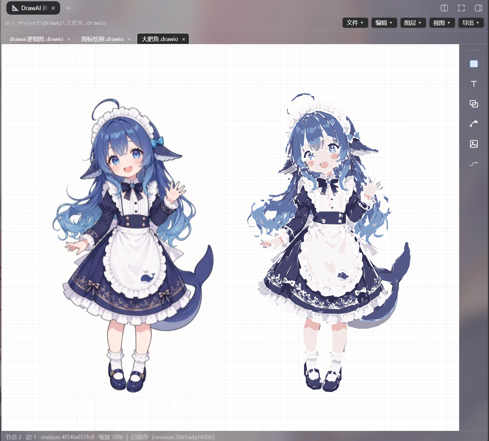
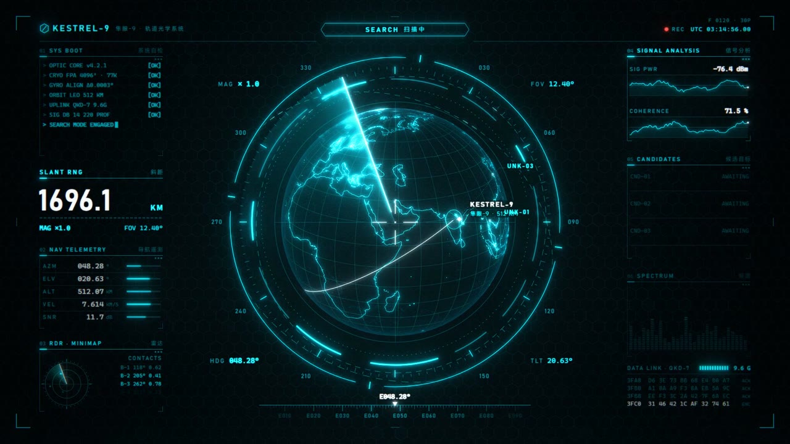

# dsh-drawai

[](https://www.npmjs.com/package/dsh-drawai) [](https://www.npmjs.com/package/dsh-drawai) [](LICENSE)

**在 DeepSeek Harness 里，用自然语言和可编辑画布一起画图、处理素材、制作动效视频。**

DrawAI 在右侧栏提供画布，也向对话中的模型提供读图、改图和视频工程工具。你可以自己拖动、连线、改字，也可以让模型继续编辑同一份文件。



## 能做什么

- **绘图与排版**：用形状、文字、表格、图层和连线制作流程图、架构图、分镜表；支持多页、对齐、查找、撤销和 SVG / PNG 导出。
- **对话改图**：描述需求，让模型读取画布、增加或调整节点和连线；选中的对象也可作为当前操作的上下文。
- **图片与视频复刻**：导入图片，生成可编辑的 SVG 复刻；导入视频后抽帧绘制，导出视频或帧序列。
- **动效视频**：用视频节点组织参考素材、镜头卡和分镜，让模型创建视频工程、编辑场景、预览帧并渲染成片。
- **声音**：导入音频，或从 Freesound 搜索音效；在视频时间轴上安排音乐、旁白、淡入淡出与节拍。

文生图目前暂未开放；已有文生图节点中的图片和数据仍可显示与编辑。

## 安装

先安装并启动 DeepSeek Harness。选择实际使用的 profile 安装插件：

```powershell
# DeepSeek Harness 桌面版
dsh plugin --profile desktop add dsh-drawai@0.4.1

# 使用 dsh web 时，安装到 web profile
dsh plugin --profile web add dsh-drawai@0.4.1
```

桌面版和 Web 分别管理插件，只需运行需要的命令。安装完成后**完全重启对应的宿主**，然后在右侧栏找到「DrawAI 画布」。

更新到最新版：

```powershell
# 桌面版；Web 版将 desktop 改为 web
dsh plugin --profile desktop update dsh-drawai@latest
```

也可从 GitHub 安装仓库当前版本：`dsh plugin --profile web add github:fourzkw/dsh-drawai`。GitHub 版本可能包含尚未发布到 npm 的变更。

> 0.4.1 将视频渲染依赖放到独立运行环境，安装插件时无需为 esbuild 授权构建脚本。首次使用某些视频功能时需要联网初始化，详见下文。

## 第一次使用

1. 打开右侧栏「DrawAI 画布」，选择 **文件 → 新建画布…**，输入名称并创建。也可以通过 **文件 → 打开…** 选择工作区中的 `.drawai` 或 `.drawio`。
2. 从画布右侧元素条选择形状，在画布上放置；双击节点编辑文字。拖动节点、连接关系，或使用图层和对齐工具整理版面。
3. 在对话里提出需求，例如：

   > 在当前画布画一个用户登录流程：输入账号密码，验证成功进入首页，失败时提示重试。

4. 模型完成后，可以继续手动调整，或选中节点后说「把这些步骤改成蓝色」；需要时通过画布的编辑菜单撤销 AI 改动。

画布文件保存在当前工作区。新建默认使用 `.drawai`；界面打开旧 `.drawio` 时会迁移到 `.drawai`，并保留原文件。格式、媒体目录和迁移限制见[原生画布与兼容说明](docs/native-canvas.md)。

## 常用工作流

### 画图和改图

画布支持形状、独立文字、表格、SVG 和位图节点，以及直线、折线、曲线、自环和悬空连线。可用多选、图层、顺序、对齐和页面切换整理内容；双击文字或表格编辑。

模型通过 `diagram_read` 读取结构、样式、选区与文件版本，通过 `diagram_apply` 增删或修改节点和边。对于并发编辑，`expectRevision` 可在文件版本不匹配时阻止写入。

例如可以继续对话：

> 在失败分支增加「找回密码」，并把验证和结果放在同一图层。

需要查看结构化操作、批量编辑和 `traceImage` 参数时，见[画布 AI 工具参考](docs/diagram-tools.md)。

### 图片和视频复刻

- **图片**：将 PNG、JPEG、GIF 或 WebP 拖入画布或从剪贴板粘贴；选中图片节点，用工具栏「绘制」设置参数并生成 SVG 复刻。原图保留。
- **视频**：导入视频后选中节点，打开「绘制复刻」，选择范围、画质和帧率；后台抽帧并绘制，完成后可导出相应格式。

复刻结果取决于原图、颜色数、细节参数及字符预算，不保证与原素材完全一致。视频格式、任务恢复和导出条件见[视频节点说明](docs/video-nodes.md)。

### 制作动效视频

**效果展示：科幻 HUD 动效**（10 秒，1920 × 1080）

[](docs/media/motion-showcase.mp4)

[▶ 播放完整视频](docs/media/motion-showcase.mp4)

1. 在画布中放置视频节点，准备文字、图片等参考素材。可通过 `shotcraft_search` 选择镜头卡并连接到视频节点；连线顺序决定镜头顺序。
2. 在对话中说明主题、时长和画面要求。模型可用 `motion_project` 建立工程并整理分镜，再编辑 `scene-*.tsx`。
3. 用 `motion_preview` 查看定调帧；调整好后继续完善场景。音频可通过 `motion_audio` 放进时间轴。
4. 使用 `motion_render` 后台渲染，完成后通过 `motion_render apply` 将成片回填到视频节点。

没有镜头卡时也可建工程；如果画布上有未连接的镜头卡，创建时会提示处理。工程结构、参考素材、样片与渲染流程见[动效视频说明](docs/motion-video.md)。

### 配音与音效

画布音频节点负责保存和试听素材；视频工程的时间轴决定音频何时播放以及音量、淡入淡出等设置。`motion_voice` 可处理旁白，`motion_audio` 可分析节拍，`motion_audio_verify` 可回测成片音轨。

Freesound 搜索结果带许可信息，使用前请自行确认是否符合用途及署名要求。详细操作见[声音制作说明](docs/motion-audio.md)。

## 首次下载与配置

基础画布可以先使用；图片、音频和视频功能在需要时可能准备额外组件，首次使用需要可访问对应下载源的网络。

| 组件 | 何时使用 | 默认位置与配置 |
|---|---|---|
| **视频运行环境** | 首次渲染、网页素材采集或风格参考帧截取 | `~/.dsh/drawai-video-runtime/`；可用 `DRAWAI_VIDEO_RUNTIME_DIR` 指定目录、`DRAWAI_RUNTIME_REGISTRY` 指定 npm 镜像 |
| **动效字体和素材库** | 建立视频工程或使用插件素材库时 | `~/.dsh/drawai-assets/v1/`；首次下载约 145 MB；可用 `DRAWAI_ASSETS_DIR` 指定目录、`DRAWAI_ASSETS_URL` 指定下载地址 |
| **FFmpeg** | 音频导入、素材探测、视频导出、帧检和混音等 | `~/.dsh/drawai-ffmpeg/<平台>-<架构>/`；也可用 `DRAWAI_FFMPEG_PATH` 指定已有程序，或用 `DRAWAI_FFMPEG_DIR` 设置缓存目录 |
| **浏览器** | 动效预览与渲染、部分网页采集 | 使用可用的 Chrome / Edge；也可通过 `DRAWAI_CHROME_PATH` 指定。部分渲染路径可能下载 Chromium |

FFmpeg 按显式路径、系统 PATH、缓存及自动下载的顺序查找，并检查所需功能。首次下载可能因网络环境长时间没有进度；当前下载器不会自动使用 `HTTP_PROXY` / `HTTPS_PROXY`。可通过 `DRAWAI_FFMPEG_MIRROR` 配置可直连的镜像，或安装完整 FFmpeg 后设置 `DRAWAI_FFMPEG_PATH`。下载失败时检查网络和宿主日志后重试。

在画布菜单的「偏好…」中可以设置网格、默认形状和配色。各组件来源和许可见 [LICENSE](LICENSE)。

## 常见问题

**安装后没有看到画布？** 确认插件装到了正在使用的 `desktop` 或 `web` profile，并已完全重启对应宿主。

**打开面板后是空的？** 先通过「文件 → 新建画布…」创建文件，或打开现有画布；空面板不会自动创建文件。

**旧 `.drawio` 会怎样处理？** 界面打开时会尝试迁移到同目录的 `.drawai`，原文件保留；若原文件在迁移后被外部修改，会提示冲突。详见[迁移说明](docs/native-canvas.md)。

**视频或音频第一次使用较慢？** 可能正在准备运行环境、字体素材或 FFmpeg。它们分别缓存；失败时查看界面提示和宿主日志，并确认下载地址可访问。

## 已知限制

- 文生图当前未开放；界面语言目前为简体中文。
- 多页可切换和编辑，但尚不支持在界面中新建页。
- `.drawio.svg`、`.png`、`.html` 这类内嵌载体不支持；部分 drawio 特有样式和单元会保留但不渲染。外链或相对路径图片不会直接显示。
- 画布导出支持 SVG 与 PNG，不提供 PDF 导出。部分大图、大画布场景的性能取决于文件规模和宿主环境。
- 音频节点需要加入视频工程时间轴才会进入成片；旁白能力依赖本机可用的合成服务或系统语音。

## 文档

| 文档 | 内容 |
|---|---|
| [原生画布与兼容说明](docs/native-canvas.md) | `.drawai`、媒体目录与 `.drawio` 迁移 |
| [画布 AI 工具参考](docs/diagram-tools.md) | `diagram_read`、`diagram_apply` 和图片矢量化 |
| [视频节点说明](docs/video-nodes.md) | 视频导入、复刻、后台任务和导出 |
| [动效视频说明](docs/motion-video.md) | 分镜、工程、素材、预览、渲染与回填 |
| [声音制作说明](docs/motion-audio.md) | 音轨、音效、旁白和节拍 |
| [设计与安装细节](docs/design.md) | 宿主集成、本地开发与实现设计 |
| [发布说明](docs/release.md) | 版本记录与素材包发布 |

## 开发

源码位于 `src/`，`lib/` 是构建产物。Node.js 版本要求见 [package.json](package.json)。

```sh
npm run build   # 构建宿主与客户端
npm run check   # 安装前烟测及源码/产物同步检查
npm test        # 回归测试
npm run watch   # 开发时监听并重建
```

测试需要能解析 `@deepseek-ai/dsh-tools`；本地开发安装和宿主重启方式见[设计文档](docs/design.md#安装)。

## License

插件采用 [MIT License](LICENSE)。第三方字体、素材及按需下载组件的许可和来源见同一文件；使用外部音效等素材时，请另行核对其许可。
