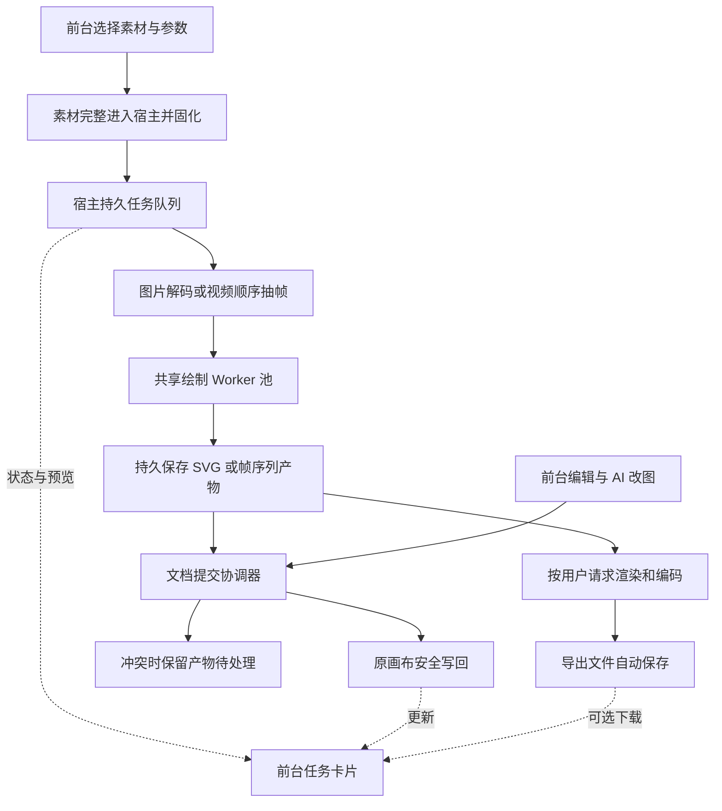

# 整体任务流后台迁移评估

评估日期：2026-10-18。以当前工作区源码为准，包含已经完成的宿主视频导出迁移。本文是评估与后续实施方案，不代表图片/视频绘制已经完成迁移。

## 结论

长时间计算、排队、素材处理、产物生成和保存适合由 DSH 宿主执行。选择文件、剪贴板、拖放定位、参数编辑、画布操作、播放预览和绘制展示动画应保留在前台。

可以实现从“素材提交完成”到“绘制、保存、按需导出”的完整后台处理。但不是把整个 `client.js` 搬进 Worker：需要拆出任务执行、产物保管和文档提交三个边界，并处理与前台编辑、撤销及媒体清理之间的关系。

这里的后台是 DSH 宿主进程，不是云端或操作系统常驻服务。浏览器冻结、切换对话或刷新不应中断宿主任务；DSH 退出、插件重载、系统休眠仍会影响执行。跨宿主重启恢复是单独阶段。

## 当前任务逐项核查

| 任务 | 当前运行位置与依赖 | 迁移判断 | 建议 |
|---|---|---|---|
| 选择文件、粘贴、拖放和放置坐标 | 浏览器文件与交互事件 | 保留前台 | 前台只负责取得用户输入，冻结目标画布/页面/位置后提交 |
| 本地素材上传 | 浏览器读取 File、分块发送，宿主接收 | 前后端分工 | 文件尚未完整到达宿主时，不能承诺关闭浏览器仍能完成上传；完整接收后转为宿主资产 |
| 视频元数据、首帧封面 | `readVideoFile` 使用浏览器解码 | 适合迁移处理部分 | 已上传的源文件交由宿主探测、生成封面，浏览器可保留即时预览 |
| 图片解码、分析、量化、轮廓与 SVG 生成 | `trace-node-image` 已调用共享宿主 Worker，但结果随 HTTP 请求返回 | 适合补成完整后台任务 | 保留已有算法；增加持久任务、独立结果文件和任务查询，脱离单个 HTTP 响应的生命周期 |
| 视频绘制的读取、seek、缩放及 PNG 上传 | `startVideoTrace` 仍创建 video/Canvas，逐帧上传 | 最高迁移收益 | 宿主读取已有源视频，FFmpeg 顺序解码与采样，送入有界 Worker 流水线 |
| 单帧视频矢量化 | 宿主共享 Worker 池，最多 4 个线程 | 已在后台计算 | 复用算法，增加原始像素输入，避免 PNG 编解码往返 |
| 相同帧、调色板复用 | 宿主帧任务内维护 | 随视频执行器保留 | 保持精确复用、颜色检查和刷新策略；不恢复近似整帧复用 |
| AI `extractFrames` 批量抽帧 | 宿主发计划，由浏览器 `extractStillsFromVideo` 执行 | 应与视频绘制一同迁移 | 和绘制共用宿主采样器，避免只迁移工具栏路径而遗漏 AI 路径 |
| 图片/视频任务队列及暂停、重试 | `drawing-queue.js` 内联进浏览器，状态在应用内存 | 必须迁移 | 宿主队列管理派发、状态与结果，前台只发命令和显示状态 |
| 绘制结果接收、节点创建、自动保存 | 浏览器 `canvas-sessions.js`、`applyPendingVideoTrace`、`saveNow` | 能迁，但需事务改造 | 先可靠保存计算产物；自动写回画布必须经过统一提交协调，不能覆盖旧文档快照 |
| AI 结构化改图、媒体写帧与布局 | `diagram_apply` 宿主处理 | 已在宿主 | 纳入统一文档提交和资源协调，不需要再绕浏览器执行；大图布局另行评估 Worker，避免阻塞宿主主线程 |
| MP4/WebM/GIF 导出 | 已由宿主 Worker/FFmpeg 完成并落盘 | 已迁移 | 保留现有执行器，后续接入统一任务目录与资源预算 |
| SVG 视频包、画布包压缩/解压 | 已在宿主，但 `buildZip` 等有同步压缩和全量 Buffer | 适合继续改造 | “运行在宿主”不等于“不阻塞宿主”；大包改为 Worker/异步流式任务，先做资源及解压边界检查 |
| 单个图片节点导出 | 原图字节浏览器直接下载；SVG 转 PNG 在浏览器 | 部分适合 | 小文件原样下载无需绕宿主；高分辨率转换、批量处理可复用宿主渲染器 |
| 整张画布 PNG/SVG、AI“看一眼” | 浏览器 `renderDiagram`、导出序列化和回执 | 可迁，但应后置 | 先抽出共用文档渲染内核，冻结文档、主题和导出参数；视频帧渲染器不能直接替代整张画布渲染 |
| 手工编辑、选择、拖动、缩放、文本输入 | 浏览器交互与本地工作副本 | 保留前台 | 低延迟反馈留在前台，保存提交通道与后台共用；复杂交互几何可考虑前端 Worker 优化，但不以其作为脱离网页的任务执行器 |
| 播放、声音、预览和逐笔展示动画 | 浏览器播放器、Canvas/SVG、requestAnimationFrame | 保留前台 | 隐藏时暂停展示合理；暂停展示不能停止后台作品生成 |
| 当前播放画面“抽帧” | 浏览器播放器当前时间与解码画面 | 保留交互，按需迁移计算 | 当前时间由前台提供；SVG 可直接取对应帧，原视频可按确认时间由宿主生成静帧，需校准取帧差异 |
| 媒体清理与临时文件回收 | 宿主，当前按调用传入 doc 的引用决定 | 必须先强化协调 | 清理依据需包含所有页面、活动任务输入/输出和待应用结果，不能只看当前页 |

关键源码：`src/client.js` 的 `startVideoTrace`、`generateImageTrace`、`extractStillsFromVideo`、`buildExportSvg`、`saveNow`；`src/drawing-queue.js` 的 `blocked`；`src/canvas-sessions.js` 的 `consume/acknowledge`；`src/index.js` 的 `handleSave`、`diagram_apply`；`src/media.js` 的 `cleanupUnreferencedClips/buildZip`；`src/video-export.js` 的 `runJob/start/list`。

## 不能直接照搬的关键边界

### 计算队列不能等待前台展示或保存

当前 `blocked()` 会让同一页面后续任务等待前一个 `ready_to_apply/applied` 任务。页面长时间未接收或保存结果，即使把视频抽帧换成宿主 FFmpeg，后续任务仍可能无法派发。

应分别管理：

- 执行状态：排队、准备、运行、暂停、已生成、失败、取消、中断。
- 交付状态：待加入画布、已加入、冲突待处理、放弃。

产物持久保存后释放计算槽位；等待画布接收的独立任务不阻塞后面的计算。确实依赖前一任务产物的任务，按明确的任务依赖等待“产物就绪”，不等待动画播放或页面打开。

### 后台写入画布不能绕过前台工作副本

当前 UI 保存以文档快照加 revision 提交，交互撤销使用浏览器内存快照；AI 改动还有另一套宿主撤销记录。当前 `saveInFlightRef` 只串行化一个视图的请求，不是覆盖所有会话和宿主写入入口的全局文件锁。

后台任务若直接保存整张旧快照，会与用户编辑、另一个会话的保存、AI 改图发生冲突。刷新读取外部新版本也会清空 UI 历史，不能把“后台文件已更新”直接等同于“已有 Ctrl+Z 行为仍保持”。

自动写回需要：

1. 所有插件内写入入口以规范化的文件身份串行提交，包括 UI 保存、AI 改图、后台结果、撤销和另存为关联操作；提交时重新检查 revision。外部编辑器的修改继续走冲突检测，不能声称仅靠进程内锁就控制了外部写入。
2. 后台提交的是新增结果节点等明确操作，应用于最新文档，不使用任务开始时的整张快照覆盖文件。
3. 校验稳定页面 ID、来源节点 ID、素材摘要和图层状态；当前以页面下标绑定任务，页面重排/删除后的身份需要额外处理。
4. 用 taskId 和稳定结果节点标识确保幂等。文件已写入但任务确认尚未落盘时，重试应认出已有节点。
5. 处理前台尚未上传的编辑。页面无心跳并不证明没有未保存数据；需要可确认的编辑提交边界或操作日志，遇到不确定状态保留结果，不能猜测覆盖。
6. 定义后台生成的撤销事务。首次可保持“回前台后经原通道一次应用、一次撤销”；完整无人值守写回应有可恢复的生成事务/逆操作，避免用整张历史文档回滚其他更新。

计算和产物保存可以先后台化，完整“无人值守加入画布并保存”必须在上述协调完成后交付。两者应明确区分，不把前者宣传成整条流程已经脱离网页。

### 输入、临时产物与清理需要统一登记

当前媒体清理从传入 doc 收集 clip 引用，未接收活动任务引用集合。后台并行任务增多后，未加入画布的输出和正在读取的素材需要租约保护；还需要扫描文档所有页面。这里是根据代码发现的潜在并发风险，不是本次复现到的数据丢失。

任务以会话、工作区、规范化画布路径、稳定页面 ID、来源节点及素材摘要绑定。源视频/图片先固化为宿主可读资产，参数、算法版本及复用规则一并冻结。新增自动暂存和提交过程，不增加“请手工确认保存后再绘制”的步骤。

### 执行器共享资源预算

现有绘制池最多 4 个 Worker，导出最多 4 个任务，每个 FFmpeg 编码器配置 4 个线程。目前没有贯穿绘制、导出、解码和压缩的统一预算。

新任务调度应统一限制 CPU、内存、在途帧及临时磁盘。初期沿用一个视频绘制任务、内部最多 4 帧计算；导出与压缩也受全局预算约束，避免每个任务各自新建大池。有界队列满时暂停解码读取，不能无限缓存或丢帧。优先保证画布读写和状态查询及时响应。

## 建议目标任务流

“按用户请求导出”可使用任务产物作为输入，无需先等待浏览器把生成结果放入画布。上传完成后的计算与导出不依赖网页订阅者是否在线。UI 隐藏时只停止预览和降低状态刷新频率。

## 实施顺序

| 阶段 | 范围 | 完成标准 |
|---|---|---|
| P0：基础边界 | 任务身份、素材固化、产物目录、活动媒体租约、文档提交与撤销设计 | 生成结果可可靠保存；清理不破坏运行任务；明确计算完成与文档保存的不同状态 |
| P1：队列与图片 | 宿主任务管理、图片后台绘制、结果查询、同页计算/交付解耦 | 浏览器刷新或退出后已接收的任务仍能依次计算，返回后不重复加入结果；首版可保持原前台应用与撤销语义 |
| P2：视频绘制与 AI 抽帧 | FFmpeg 顺序解码、原始像素入口、有界在途帧、共用采样器 | 视频绘制和 `extractFrames` 均不再需要 HTML video/Canvas、PNG 上传或浏览器心跳 |
| P3：完整后台交付 | 统一文档提交、稳定页面身份、幂等写回、冲突处理和生成撤销 | 页面不在时也能安全加入并保存结果；有冲突保留产物，不覆盖用户未提交的更新 |
| P4：统一任务与恢复 | 已有导出接入共同任务目录，持久历史与检查点 | 重启后恢复真实状态；未完成项明确标记 interrupted；输入和算法一致且已验证时才开放续绘 |
| P5：补充耗时流程 | 批量封面/静帧、压缩解压、整画布导出与 AI 看图 | 分别按瓶颈迁移，整画布渲染需通过样式、字体、路线、背景和选区一致性回归 |

FFmpeg 与浏览器的取帧、方向、像素宽高比、色彩范围及透明通道可能不同。视频新路径需要校准首尾采样、切镜、29.97/30fps、暗部/亮部与蓝色头发等既有样本，不能仅用帧数正确就认定画面等价。复用策略继续保持“精确整帧复用 + 检查合格的调色板复用”。

跨宿主重启的任务列表恢复不等于断点续跑。绘制检查点需要连续已提交帧、输入摘要、算法版本、调色板及刷新位置等；不完整或不一致时应重新开始。FFmpeg 编码进程不能通过恢复一条进度数字继续，应从可靠的已保存输入重新编码。

## 验收清单

1. 单图及同页连续多图在无前台状态查询、无结果应用回执时仍能依次计算并保存产物。
2. 视频绘制开始后冻结或刷新网页，不再调用浏览器 seek、Canvas 或逐帧上传，宿主独立完成。
3. 图片、视频、AI 抽帧和导出都能通过原任务身份重新查询；不同会话和画布保持隔离。
4. 前台已有未保存改动、AI 正在改图或外部编辑器更新文件时，不以旧快照覆盖新内容。
5. 页面重排、来源替换/删除、图层锁定和画布另存为后，不把结果插入错误目标。
6. 返回画布或重复请求不重复插入；每次生成的撤销范围明确且不回滚无关编辑。
7. 任务未开始、正在解码、正在计算、已生成待交付等阶段的取消和重试均可验证，清理不误删有效产物。
8. 执行媒体清理时，所有页面引用、正在运行的输入、待应用输出及其音频来源都被保护。
9. 视频测试覆盖首尾帧、切镜、方向、色彩/暗部、透明度、固定及小数帧率、音频片段起点；不靠降低用户参数获得加速。
10. 宿主退出后不把未完成任务显示为成功；已保存结果仍可使用；恢复列表与续绘能力分别说明和测试。

## 2026-10-18 实施结果

P0–P4 的核心路径已落地：`drawing-tasks.js` 管理持久任务与队列，`drawing-runner.js` 负责宿主图片/视频绘制及 FFmpeg 抽帧，`task-coordinator.js` 串行化 UI 保存、AI 修改、后台提交与撤销。`drawing-results.js` 只向最新文档追加生成节点，`task-patches.js` 协调已知后台增删与前台工作副本及历史。未知修改仍是冲突，保留本地编辑与任务产物。

计算和交付分离；当前页没有接收者或提交等待文件锁时，不阻塞后续计算。输入快照在接受任务后固化；成功后释放输入文件。视频使用原始像素 Worker 入口、有界流水线、精确帧复用及经过检查的调色板复用。恢复按同一采样网格从原起点解码并跳过已提交帧，校验输入、算法摘要及连续 SVG 帧摘要。暂停会保存完整帧边界；突然退出最多重算最近尚未写入检查点的帧。

绘制与视频导出共用两个重任务槽位。导出记录持久化到 `.drawai-cache/video-export-history/`，恢复后已保存文件仍可下载；未完成编码明确标为中断，提供重新导出，编码进程不承诺断点续传。绘制记录按会话/工作区恢复，列表涵盖该会话的各画布；导出列表仍按当前会话及当前画布展示。媒体清理包含所有页面及磁盘任务租约。

任务面板统一展示图片、视频、抽帧与导出，提供状态筛选、准确帧进度、排序、暂停/继续、取消、失败重试、算法更新后的重新开始、打开目标页面、结果回放和单项生成撤销。计算成功、已写入画布、交付冲突与已撤销分别展示。

P5 中 AI `traceImage` / `traceFrame` 的矢量化计算已移到共享 Worker。整画布 PNG/SVG 导出、AI 看图仍依赖现有浏览器渲染器，交互预览、选区与播放也保留在前台；压缩打包仍是原宿主路径。它们没有被标为已完成的无人值守后台任务。整画布渲染需另外完成字体、样式和路线一致性验证后迁移，避免改变输出。FFmpeg 必须在宿主可用（PATH 或 `DRAWAI_FFMPEG_PATH`）；变更宿主代码后需重启 DSH。

新增验收：`check-background-tasks.mjs`（真实图片/视频/AI 抽帧、无人值守队列、工作副本合并、撤销保护、会话隔离、暂停前后采样一致、检查点损坏及重启恢复），`check-background-ui.mjs`（筛选、排序、进度、恢复操作及错误反馈）；导出测试补充跨宿主实例历史及下载恢复。现有画风、暗部色位、视频帧率和音频回归继续保留。
